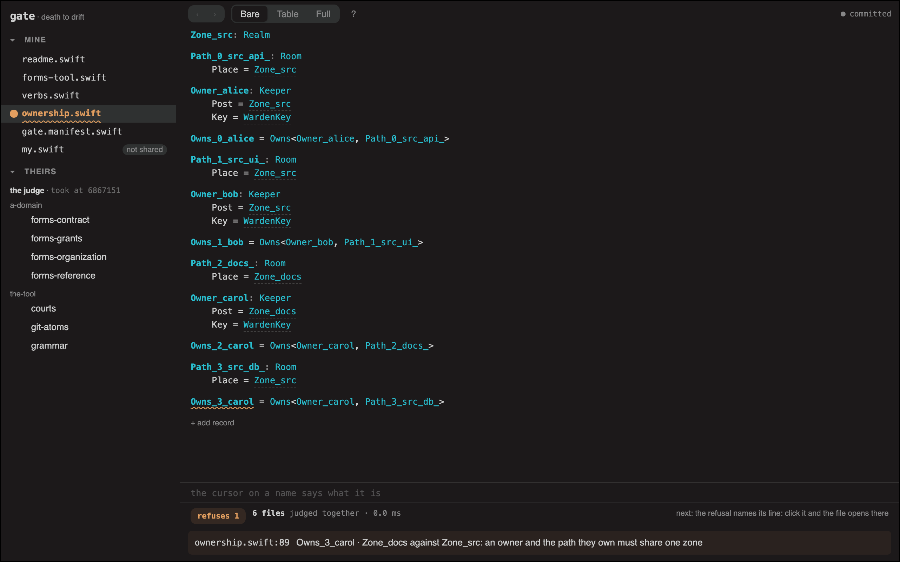

# gate · death to drift

Your repository is full of sentences that must match something, and nobody
checks the match. The schema must match the service that writes it. The
rota must match who actually answers. Each pair held the day you or a
colleague wrote it down, and nobody records the day the two stop
matching.

One case, to be concrete. CODEOWNERS hands `/src/api` to @alice. The folder
was renamed to `/services/api` in the spring. The rule now matches nothing,
reviews still go to Alice, and no tool reports a problem: there was no
event on either file to notice. You find out at
an audit, or the day a colleague merges what nobody reviewed.

That gap has a name: drift. Two records of one fact, coming apart in
silence, while both still get obeyed.

You know it by its local names: config drift, doc rot, schema drift, a
stale CODEOWNERS. The mechanism is one: two records, and nobody
compares them.

The usual cure is to pick one place and call it the source of truth. But a
source has a direction: everything downstream must watch it, and it watches
nothing. The folder was renamed in a pull request that never read the file.
A file everyone must keep current is a chore for everyone, so it is a chore
for nobody, and the chosen file goes stale like any other. gate starts from
the opposite fact: there is no source, so there is no direction. The team
that owns the folders declares them, once. The review rule declares the
folder it points at. Two declarations about one folder cannot differ in
silence. Either they are equal, or you get the exact point of contact:

```
$ gate status
status: refused 1 · 13 equalities
  ownership.swift:89 · Owns_3_carol · Zone_docs against Zone_src: an owner and
                       the path they own must share one zone
```

That is a CODEOWNERS rule, translated once, judged on every change: carol
keeps `docs`, and one line assigns her a folder in `src`. The refusal
names the file, the line, and both sides of the disagreement. A diff
compares two texts. This compares two claims about one thing.

The same refusal on the live page (`gate serve`), at its line. The picture
is a door, and so is this line: [the same bench, live in your
browser](https://danielswift1992.github.io/gate/?f=ownership.swift:89),
over the demo, judged as you type.

[](https://danielswift1992.github.io/gate/?f=ownership.swift:89)

The check is one lookup per claim and nothing else: no search, no solver,
no build. The cost is linear in the number of claims: milliseconds on a
real repository, and still milliseconds when the repository is ten times
the size. So it runs on every keystroke, in every commit,
and in CI, with nobody waiting on it. The sentence is measured:
docs/BENCH.md carries the numbers, and `python3 bin/bench.py` reprints
them on your machine.

No server. No runtime. No new formats. Nothing leaves your repository.

## try it on your own repository

The zero-install way, from inside any clone you already have: one command
downloads the pinned release binary, checks its sha256, judges your
CODEOWNERS and your workflow filters, and prints every refusal at its line:

```sh
curl -sL https://raw.githubusercontent.com/DanielSwift1992/gate/main/bin/gate-audit.sh | bash -s v0.2.5 .
```

Or take the tool itself:

```sh
git clone https://github.com/DanielSwift1992/gate && cd gate    # no install step
./gate import codeowners CODEOWNERS --tree . --policy owners.csv -o ownership.swift   # your own ownership, judged
./gate drift ../api/openapi.json --client ../sdk-js   # your contract, your client
./gate serve                                   # the same facts as a live page
```

Run the first two lines in repositories you already have. Ownership is a
fact you already keep, in a file that cannot say whether an
owner exists or whether a pattern still matches anything. The command
turns it into a judged world, and you write none of it: it writes one
small Swift file, `ownership.swift`, and no Swift toolchain is involved,
because the judge reads it directly. Drop the `-o` and it writes nothing
at all: the same reading, printed, and your repository left as it was.
`owners.csv` is two columns, and it
adds the one thing CODEOWNERS cannot express: which zone each owner
keeps.

Now break what you just imported. `./gate serve` opens the bench on it:
rename the folder inside the declaration, and the refusal lands on that
keystroke, at its line. `./gate status` in the terminal says the same
thing, word for word. Commit it, and the next section's one `uses:` step
has CI say it again on every push. Same judge, same declarations,
different moment.

`drift` reads an API contract and a client library out of git on your
machine, and prints what the copies have been doing to each other.
It uploads nothing and fetches nothing. It observes rather than
judges: the exit code follows a threshold you declare (`--fail-over 30`),
never a verdict of ours.

No repository of your own at hand? `gate demo` installs the [CODEOWNERS example](examples/README.md): a small tree
with a CODEOWNERS whose one rule reaches outside its zone, so the first
thing you see is the refusal above. Everything it makes is committed the
moment it is made, and `git checkout .` is the whole way back.

Every command here is written `gate`. Until it is on your path it is
`./gate`, run from the clone: nothing else to install, nothing else to
undo.

## run it in your CI

One step checks every CODEOWNERS rule and workflow `paths:` filter
against the files that actually exist, on every push:

```yaml
- uses: DanielSwift1992/gate@v0.2.5
```

A rule that points to a deleted or renamed path fails the check, with
the file and line in the log and as an annotation on the pull request.
A repository with no CODEOWNERS and no path filters passes, and the log
says there was nothing to check. `version:` picks the gate release,
`tree:` checks a subdirectory instead of the root.

## ask the file, not a person

The state of the art for these is a search: grep, a ticket, whoever
remembers. Here each is a lookup against the file, in milliseconds:

| The question | Today | Here |
|---|---|---|
| May this person read this document? | ask the owner, or read the ACLs by hand | `gate check view Emp0042 FinanceShare` |
| What breaks if we move them to Sales? | find out after the move | `gate diff transfer Emp0042 Sales` |
| Who may merge this, and since when? | convention, and memory | `gate guard merge` · `gate log` |
| Which commit broke this rule? | bisect by hand, if anyone notices | `git bisect run gate status` |
| Is anything inconsistent right now? | an audit, quarterly | `gate status`, on every keystroke |

`check`/`ask` reads a declared view. `diff`/`change` previews a transfer, grant or revoke; `apply` keeps it when its judgement holds. Add other declarations by editing the world file in the bench or your editor, then judge the result. Organization’s `Administer` and `Delete` laws belong to its Swift types in showcase and are checked by the compiler there. The world is selected by its local file or manifest.

The names come from a sandbox this repository makes for you; your own
commands use your own names. You pay once, per name you
translate. Every question after that is a composition of what you already
translated, and compositions are free: the opposite of a reporting tool,
where each new question is new work. The tool is general; the table is
one example. You point it at any pair: a Jira ticket and the TODO that
cites it, k8s RBAC and the cluster
it describes, an API contract and a client in another language.

Two of those pairs are one command each today, because the half you keep
is already a file somebody else's machine obeys:

```sh
./gate import codeowners CODEOWNERS --tree . --policy owners.csv   # who owns what
./gate import workflows --tree .                                   # what wakes a workflow
```

The second reads the `paths:` filters your workflows are woken by and
holds them against this tree. A filter naming a folder that was renamed
goes on being obeyed and wakes nothing: no red line, no log, no mail.
It reads the filter by its address in the document, and a file it cannot
read exactly it names, with the line, rather than guessing at it.

## find your drift

Yours is wherever two places state one fact. Take a thing you shipped this
month and ask: where is this written down, and where else? Who checks the
two against each other, and when did anybody last do it? The pairs you
cannot answer for are your drift, and every team has them: the schema and
the service that writes it, the contract and the client, the rota and the
pager, the config nobody dares delete.

You are looking for pairs, not objects: one fact always has more than one
record. And the loudest marker is anything that calls itself the source of
truth: a self-declared source is the record nobody compares to the others
any more, so that is usually where drift collects.

Gate first the pairs that cross a boundary: two teams, two repositories,
two languages. A fact drifts where it changes hands.

The quick first look is one command, over the git history already in your
clone. `gate findings` prints plain sentences: who changed which facts,
across how many commits, and whether any hook or workflow checked those
edits. `gate findings --history` says when a pair parted and how much has
passed through since. It needs no setup and judges nothing yet: these
are readings, not verdicts.

Something drifts? Gate it

## gate it

To gate a pair: put your half of it in a file, once. From then on every
change is checked against it, and the other side sees it the next time
they check.

If your half is already a table (CODEOWNERS, a CSV), one command puts it
in, and your file stays in place: whatever read it keeps reading it. What
enters gate is a second record of the same fact, the kind of pair this
tool exists to hold. A CSV round-trips: `gate export` prints the tables
back, and the diff against the originals is empty. A CODEOWNERS is judged
against your tree as it lands: the refusal at the top of this page is
exactly that, a rule reaching outside its zone, and a pattern that
matches no file is named beside the verdict. And the two stay compared:
the world names its source on its own `from:` line, every `gate status`
translates the file again and holds the two together, and a line changed
on either side alone is named at its line. If your half is not a table,
you write it as a file yourself: a page of plain declarations, translated
by hand, once. The rules are small, and they are yours to read. That is
the upkeep, all of it.

The same move works between teams. You do not test my API, and I do not
mock yours. Each side states its half in its own repository, the seam is
judged, and a disagreement is named at its address on both sides. What
used to be an integration test is a verdict.

You already write claims: every line of CODEOWNERS is one. These seven
lines are that claim with its parts named: the zone, a path in it, an
owner posted to it, and the tie between them. `gate bare` prints them,
from the demo's `ownership.swift`:

```
Zone_docs: Realm

Path_2_docs_: Room
    Place = Zone_docs

Owner_carol: Keeper
    Post = Zone_docs
    Key = WardenKey

Owns_2_carol = Owns<Owner_carol, Path_2_docs_>
```

The file on disk is full Swift, `gate bare … --full` prints it, and
`swiftc -typecheck` reads it as it stands: this view is a projection
over that one source, never a second copy of it.

The judge asks one question of every claim: the same, or not, and at
which line. The files are bare Swift: the same language with the ceremony stripped,
and no DSL. Records are declarations, rules are type constraints in the
same text, so a record that violates a rule does not get flagged: it fails
to exist. And because it is plain Swift, a second, independent reader
exists whenever you want one: `swiftc -typecheck` passes on these files as
they are, with no project and no build. Git keeps doing what it already
does best: history, authorship, review, rollback.

The porcelain is deliberately git-shaped: `status/fsck · demo · init · serve ·
publish · findings · bare · log · survey · drift · check/ask · diff/change ·
apply · guard · library · mine · theirs · my · declare · seam · attention ·
aside · import · export · verify · badge · report · stdlib · --version`. A refusal exits
non-zero, so hooks and CI need no wrappers, and every command ends by
naming the one step that comes next, so the whole ladder stays out of
your head. `gate stdlib show forms-organization` prints any shelf page
exactly as it shipped.

## what this does not touch

A drifted record is one problem: two spellings of one fact, and the
judge names the line where they part. What two people mean by a record
is another problem, and no check turns two readings into one. gate does
not try. Its one move is to put the agreement in writing before the
argument: each side states its half in its own file, the judge compares the
halves from then on, and you hold a meeting when the verdict says you
differ. If CODEOWNERS hands the payments folder to an intern,
the rule holds and every record agrees with it. Whether it should is a
claim you can state too: write it as policy, let the other side write
theirs, and the verdict says if you agree. Agreement here is not
assumed. It is stated twice, and confirmed.

## death to drift

Every pair you gate is one thing you stop keeping in your head. An
unwritten agreement has no address: to obey one, you remember them
all. A gated pair has an address: the judge brings the one line your
change touched, and the rest stay written. Today
you keep other people's facts by hand: you review renames because
a stale rule routes them to you, you spend audit week rebuilding
answers, and you remember what breaks when a path moves. Gate a pair
and you state your half once; the judge holds it from there. Agreement
is a verdict: a break is named at its line, on the breaker's screen,
the day it lands. A rename goes red for the renamer. A new hire's
access is one diff with an owner's name on it. Deleting an old config
takes an afternoon, because its readers are a list. The checking does
not pile up: a claim is one lookup, so a hundred pairs cost what ten
did. Your work did not get faster. The asking is gone.

## the rest, one page deep

The cover you just read is the product. The pieces below are one file
away, each where you would look for it:

- [docs/DETAILS.md](docs/DETAILS.md): carrying gate vendored in your
  repository, verifying the zero-egress contract yourself, where it plugs
  in (hook, CI, review, editor), layout and ownership, and the arithmetic
  of why a judged pair pays.
- [docs/SECURITY.md](docs/SECURITY.md): what a verdict promises, and where to
  report a wrong one.
- [docs/CHANGELOG.md](docs/CHANGELOG.md): what exists, in the order it came to be.
- After `gate init`, your repository is met by a letter of its own:
  `stdlib/readme.swift`, beside your files and judged with them.
- `gate init --ci` writes the other half of the same step:
  `.github/workflows/gate.yml`, which takes one binary from the latest
  release and asks it for a verdict on every push. No toolchain on the
  runner, nothing to install, and a step already there is left alone.
  The hook holds a commit on the machine that makes it; this holds what
  arrives.

## what you just cloned

```
LICENSE         MIT · docs/NOTICE.md lists the bundled pieces and their terms
gate            the shim that finds the binary: an explicit GATE_CLI, this
                clone's own build, a copy carried in by `gate init --vendor`,
                or one on PATH. It says so in one sentence when there is none
gate.cmd        the same shim on Windows, in that platform's own spelling
action.yml      the door for a stranger's CI: one `uses:` step fetches the
                released binary at a pinned tag, checks the sha256 published
                beside it, and judges the tree it stands in (the step is
                bin/gate-audit.sh, and the battery runs its vectors)
gate.manifest.swift
                this repository's own declared layout: its worlds, their
                roles, and the judge's row, judged like anybody's
CODEOWNERS · owners.csv
                who owns this repository, and the zone that owner keeps:
                the two files the first recipe above reads, kept here for
                the same reason yours are kept in yours
ownership.swift this repository's own ownership, printed from those two by
                the command CODEOWNERS itself names, and judged with the
                rest of the world
gate.policy.swift
                who keeps this repository, said once: the email git
                records bound to the keeper ownership.swift declares. A
                name the world does not declare is refused at this line
bin/gate-judge  the judge, one static binary, built at a pin from the
                public theory corpus, verification-is-identification:
                github.com/DanielSwift1992/verification-is-identification
                (bin/build-judge.sh [pin] rebuilds it): the certificate
                and count courts
bin/organization-judge
                the company's plain court, built from the theory's
                showcase, where the policy it reads is declared:
                github.com/DanielSwift1992/verification-is-identification-showcase
                at the pin bin/organization-court.from names
                (bin/build-organization-judge.sh rebuilds it), held to the
                showcase's organization court contract
bin/judge.js · bin/judge-cli.js · bin/judge-wasm.js · bin/court-wasm/
                the courts for machines the binaries were not built for:
                the plain court as a node port held to bin/organization-judge
                by organization v0.1 (8/8) and v0.2 (25/25), and the battery on the
                company's worlds, and the certificate and count courts as the
                contract's Rust sample, a second implementation built for
                wasm32 at the pin bin/court-wasm.from records
                (bin/build-court-wasm.sh rebuilds it), held to the binary by
                the suite and the battery. The port reads no `where` clause:
                where and count are the sample's alone. The plain verdict reads
                the company's fixed table and fragment, including the reference's
                refusals on foreign forms. Richer inspection records support the
                bench without imposing additional domain requirements. A zero exit
                with zero company premises does not validate a foreign domain.
                Passing these finite suites does not establish general equivalence.
bin/renderer.js · bin/press.js
                the browser port of DocumentKit, held to the owner's executed
                Contracts/Drawing/v0.1 through bin/playground-worlds.from.
                tests/drawing.js compares exact input hashes, SVG bytes and
                addressed refusals. Unsupported forms refuse instead of drawing;
                an explicit Backdrop is currently outside this port's subset.
                DrawingProfile.Contract takes the same pinned owner input.
                drawing-profile.js compares the current bytes and actual output
                in both serve and static pages. Exact cases say compared, edits
                say port-under-contract, and At scale stays not-compared.
                The published bench also reads its manifest and personal record;
                that larger input stays port-under-contract even when its SVG
                equals a native case. No extra source is discarded for comparison.
                XYZRatioWrite prints the palette's explicit integer scale,
                without asking Half for a fractional count. This contract does not
                establish equivalence to arbitrary Swift.
bin/press-contract.from
                Press belongs to VI Sources/Court/Press.swift. Its pinned v0.1
                contract holds press.js to 33 substitution and Character cases,
                including rubout of a non-BMP or combined character. The bench
                and the contract use the same applier. Intl.Segmenter supplies
                Character boundaries; without it the literal press names an
                unsupported operation and leaves the state alone. The battery
                runs the owner's driver (tests/press-contract.py); this finite
                suite grants neither arbitrary Swift coverage nor atomic file
                publication. bin/drawing.from retains the historical renderer
                replay, whose old controls still run over the current press.
bin/grammar-law.from
                vi's scope reader and compiler-derived grants, pinned together;
                a world's Language supplies imports, definitions and its own
                source scope map. [The context contract](docs/LANGUAGES.md).
bin/gate-cli.swift
                the CLI, one file of Swift: every verb this tool answers,
                with the courts compiled in at their own pins
                (bin/build-cli.sh builds it; the binary is not committed,
                because every executable line here stays text)
bin/shelf-into-swift.py
                the shelf, written into the build as text so the binary
                carries it: a downloaded gate has no stdlib/ beside it. The
                pages themselves stay in stdlib/, and the battery holds what
                the binary carries against them, page for page
stdlib/         the judge's own words, printed as real Swift files, each
                judged by the question it asks: certificates by the where
                court, the bench's numbers by the count court against the
                corpus's Primitive at the pin, and a page that claims
                nothing is said to claim nothing
bin/playground-worlds.sh
                the showcase worlds at bin/playground-worlds.from: every selected
                file has its SHA-256, checked again on a cache hit. The compiler's
                theory and the court's pin are recorded separately there.
bin/build-pages.py
                builds an explicitly named repository or the pinned catalog;
                commands are in docs/DETAILS.md. The worlds mode publishes the
                worlds from the pinned Site/Manifest.swift, read in THEIRS, with
                serve's recorded answers. playground/ opens Read me in that
                same bench. CI selects examples/codeowners for gate's own site
                root, the world shown on the cover. Each pinned showcase world keeps
                its own saved files by revision, world and file. Page bodies at
                the pin compile in showcase; browser edits have no Swift proof.
                Editable static worlds keep reader text with its reading, including
                refusals. Selected repositories keep complete file drafts;
                large drafts in pinned worlds keep lossless source splices.
                Reopening judges the text again. Previous browser drafts stay readable.
                This does not write the repository:
                serve writes a file only when that file holds.
                Static pages keep file drafts, not structural writes: changing
                the manifest, declaring a file or answering a table value
                refuses with an address. Change the source with gate serve and
                publish again. A failed disk write in serve refuses too.
                A mixed company page names its data boundary explicitly; the
                company court reads below it, at the original line addresses.
                SHOWCASE_SOURCE names a local source at the pin; the published
                worlds-source.json says local. The default fetches the public pin.
bin/drawing-profile.js
                the browser transport for the owner's resolved profile, and
                the labelled port for a live MINE palette. Native publish and
                serve check the owner's input hashes and carry its CSS.
                Font, license and receipt have shared hash addresses.
web/ui.html     the workbench; bin/judge.js judges it in the browser
web/codemirror.*  the editor (CodeMirror 5, MIT, vendored)
demo/           runnable worlds: CODEOWNERS + policy, CSV org, K8s RBAC
docs/           DETAILS.md, SECURITY.md, CHANGELOG.md, NOTICE.md, and
                the cover's picture with its provenance
tests/smoke.py   the battery: 748 checks this repository holds itself
                 to, end-to-end runs through judge parity through
                 documentation contracts; the definition of green
tests/windows.py the Windows measure: the reviewer's road as asserts
```

The battery count is generated from its registrations by
`python3 bin/battery_count.py`. Run that command after adding checks or
merging branches. The tool also has a read-only verification mode, listed in its help.
The battery checks it before building and compares the run with the registered
cases at the end. A run without swiftc says it is short and stays red.
The finished-page width check needs headless Chrome or Chromium. It reads every published bench at 375 and 1280 in both themes, and must catch the old answer that would not wrap.
The court contract totals below describe pinned suites, separately checked
by the battery; they are not additional battery totals.

Each decision prints a `TIMING` record: seconds since the preceding decision and elapsed time for the run. The first includes the CLI build and setup. The healthy CLI is built once; the changed-source refusal control still gets its own build. The full battery keeps a forty-minute deadline.

The published world contracts run beside it on Linux and macOS. `tests/playground_runner.py` takes an explicit deadline and log destination, recorded in the workflow. A refusal names its phase, active source and longest readings before the output tail.

## what runs today, and what is next

```
$ gate badge
badge: 179 claims · holds
```

The badge is this repository's own, and the judge re-counts it on every
run.

Working prototype under active development, MIT licensed: see LICENSE,
and docs/NOTICE.md for the bundled pieces and their terms. The judge is a
native binary, and each of its courts has a versioned canon: the plain
court two, the certificate court four, and the count court its own
question (stdlib/courts.swift). The CLI is one file of Swift, built into a single
binary the way git is one tool.
We want to hear
about a wrong verdict before anything else: see docs/SECURITY.md.

**Where it runs.** The CLI is one binary, built from one Swift file by
bin/build-cli.sh, and the bench is a page. `gate` is a shim that finds that
binary, so a clone that has not built one says so in a sentence with the
two ways out. The judge is a native binary built for one platform: `bin/gate-judge`
here is `Mach-O arm64`, and on any other machine it does not execute. On
such a machine node runs the courts instead: `bin/judge-cli.js` runs the plain court, ported line for line, and hands `judge where` and `judge count` to `bin/judge-wasm.js`, the contract's Rust sample built for wasm32 at the pin `bin/court-wasm.from` records. The battery reads the owner's byte-bound suites through `bin/court-contract.from` at the same pin as both carriers: v0.1 13/13, v0.2 12/12 and v0.3 38/38. The third release keeps LF, CRLF and CR on the same logical lines, including refusals; a changed input hash or split carrier pin refuses before the comparison. Agreement on these finite cases does not claim whole-language equivalence.
`gate --version` says which court ran on your machine. On macOS, CI runs
the full battery on every push. On Windows, CI builds this same one file
into that platform's own binary on every push, asks it what it carries, and
walks the road a reviewer walks: `tests/windows.py` makes the demo, takes
the kit, breaks a claim, and the break is refused at its line, on that
platform's own paths.
On Linux, CI rebuilds the judge at the same pin and runs the full
battery on every push, so every platform named here is measured. A release
carries the binary per platform, and beside each one its court's revision
and a sha256: the honest check is the rebuild, and both are one command.

Roadmap, next: apply routing over the declared
layout · more domain forms.

Something drifts? Gate it

Publish a declared repository with `gate publish /path/to/repository -o /path/to/site`.
The current binary delivers `publication/1` with `ReadOnly`, including the bench,
stdlib, browser court and an optional owner-resolved drawing profile. `NoDrawing`
selects none; a pinned `DrawingProfileFile` names the owner's CSS and input receipt.
It needs Git for declared pinned inputs; it
needs no Python, Node or Swift at publication time. Serve the same repository with
`gate serve /path/to/repository`. The record format and current supported boundary
are on `gate stdlib show forms-publication`. The existing `build-pages.py` showcase
recipe still builds gate's own showcase site.

The [profile input](docs/DRAWING-PROFILE.md) binds the actual palette, bindings,
font, metrics and license. A changed input needs another reading at the owner.

The read-only browser checks delivery with Web Crypto over HTTPS or localhost;
a missing capability or damaged resource removes the verdict.

The [boundary law](docs/BOUNDARIES.md) checks declared dependency debt through a pinned owner implementation.

### Publication byte boundary

`python3 tests/publication-boundary.py` checks tracked source files for the path class; declared source identities are not silently removed. Its artifact and publication-tree options check explicitly selected release bytes or every file of a built site; the Python helper’s help lists their syntax. The wasm builder, Pages builder and release job use this same law; it has no dependency on the subject-boundary ledger or Git history. A missing input refuses with its address. Refusals name the file, representation and zero-based byte offset. A masked sample shows the recognized path root followed by redacted account components (also hiding UNC server and account-temporary identifiers), or only the email domain; a standalone builder name is redacted. The current private builder name is also masked if it appears in that domain. Private path suffixes and email local parts are never included in the sample.

The finite path class is absolute POSIX account homes under `/Users/<account>/` and `/home/<account>/`, nonempty paths under the root account's home, Windows drive/UNC account homes, and macOS account temporary paths under `/private/var/folders/<bucket>/<account>/` (also without `private`). Account components include Unicode word characters (letters, numbers and underscore), dots and hyphens. POSIX spelling is case-sensitive, and a root cannot follow an ASCII letter, digit, underscore or hyphen. Thus lowercase user API routes and embedded URL path components are outside the class. macOS Shared is not an account home. Examples should use `~/…`.

Generated artifacts and publication trees are also checked for the current local build username bounded by bytes other than ASCII letters or digits; the current CI account is not attributed as author to every tracked source. The policy declares the CI service accounts `runner` and `runneradmin` (case-insensitive): their names are ordinary product words and are not searched as private names, but their home paths still refuse. No private username or username fingerprint is stored in the policy. An unknown historical username by itself is not claimed detectable; historical home paths remain in the path class.

Generated artifacts and publication trees are checked for ASCII mailbox addresses with a DNS domain ending in a letter-only label of at least two characters, including email followed by a sentence-ending dot. The full domain is read before applying the policy's reserved example domains; these synthetic mailboxes are allowed. The policy also declares SCP repository addresses `git@host:path` with a nonempty path as non-email; a bare `git@host` mailbox with a DNS domain still refuses. Version pins such as `repo@v0.2.5` are not email.

These classes are read as raw bytes (Unicode path components in UTF-8), UTF-16LE/BE at either alignment, one layer of slash/backslash unescaping, and the declared browser wasm base64 carrier. A UTF-16 address names the first byte of the matched code unit, including when a Unicode prefix precedes it. Arbitrary encodings and all possible personal data are not claimed. Controls run the actual law under `USER=runner` and `USER=runneradmin`, alongside a private-name twin, and refuse all three account home paths. Linux and Windows release bytes must pass on their actual runners.

The native judge builder removes linker debug metadata before this law and before copying the result: the platform strip utility's debug-only mode (Darwin and GNU respectively; exact flags are in the builder). Compiler prefix maps alone do not cover ld64's N_OSO object paths. A build with its temporary directory inside the account-path class must still pass; moving that directory outside the class is not evidence that debug paths were removed. A linked toolchain's strings have no implicit exemption: a third-party origin needs an explicit declaration, source and control before it can change an outcome.

Known finite-class limits: reserved example domains are exact or have the declared reserved suffixes, so `person@mail.example.com` still refuses; IDN mailboxes are outside the ASCII email class; an account component beginning with a combining mark and a mail domain with ten or more labels are outside the current match. These limits do not waive findings inside the declared class.

### Published history reading

A public journal snapshot reads four fields per commit: `short` (the first eight hash characters), `when` (Git author time), `subject` and `author` (Git author name). It omits author email, email-derived identities and the local `me` field. This explicitly narrows the earlier history reading: publishing a private world must not disclose its contributors' mailboxes, which a journal reader does not need. Other journal metadata still describes the selected scope and world files. Native `publish` and the Pages recipe use the same Swift projection; the recipe requests it with `/log?publication=1` and records it under the bench's usual journal key.

Local `gate log` and ordinary live `/log` keep their repository reading. Email stored in Git commit objects is outside the publication-byte law; no repository history is rewritten. An email in the declared class anywhere in the emitted snapshot (including a subject or author name) still refuses with a byte address; it is not silently scrubbed. The publication and Pages controls retain a real commit's four public fields while excluding its author's email, and the byte-law control injects email into a journal snapshot to require that refusal.

The public journal's next action concerns publishing new history, independently of a page's draft policy. A personal file's Git-status snapshot names its logical bench file, never the private backing path. Snapshot controls refuse a relative climb through an account home in both HTML and JSON, while the logical filename passes.
